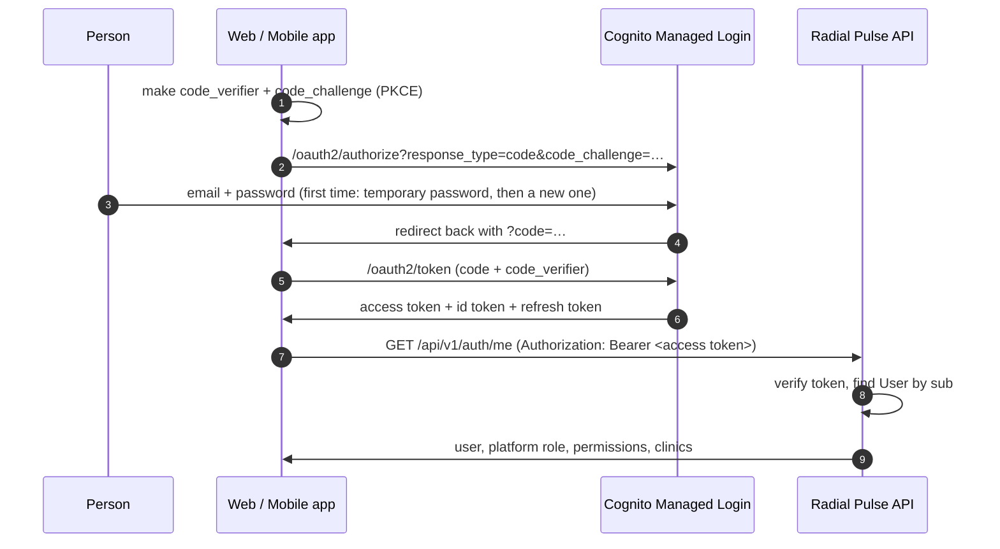
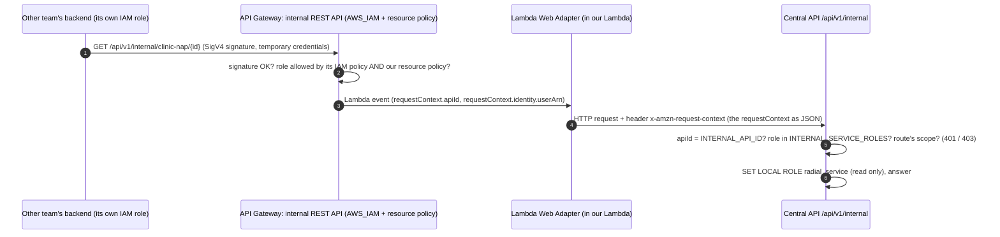

# Authentication

Two separate things, never mixed:

| Who | How | Token | Routes |
|---|---|---|---|
| **People** (staff and clinics) | Cognito **Managed Login**: email + password, Authorization Code + **PKCE**, public app clients (web, mobile) | access token, `client_id` ∈ `COGNITO_APP_CLIENT_IDS`, names a user | `/api/v1/...` (every route except `/internal`) |
| **Backend services** (other teams) | **AWS IAM**: each request is signed (SigV4) with the service's own IAM role; a separate REST API with `AWS_IAM` + Central's resource policy | no token: the caller's role session ARN from API Gateway, role ∈ `INTERNAL_SERVICE_ROLES`, scopes from that list | `/api/v1/internal/...` only |

There is no login form in this API, no password ever reaches it, there is no Google sign-in,
and there is no fake login anywhere. The AWS side of all this is set up by hand:
[manual-aws-setup.md](../infrastructure/manual-aws-setup.md).

## People: sign-in flow (web and mobile)

- **PKCE** replaces a client secret: both user app clients are _public_ (no secret).
- Send the **access token** (not the ID token) as `Authorization: Bearer …`.
- "Forgot password" and the first-time "choose a new password" step happen inside Managed Login.
- The Cognito callback (`https://<web>/auth/callback`, `<app scheme>://auth/callback`) is Cognito's;
  the API never sees it. It is not the "Connect Your Accounts" callback (`OAUTH_REDIRECT_URIS`).

## Invite-only accounts

Nobody signs themselves up (self-registration is off in the pool).

0. The **first** Platform Administrator is created from the command line:
   `make create-admin EMAIL=… NAME=…` (in AWS: a one-off ECS task). It also creates their Cognito
   sign-in.
1. A Platform Administrator invites Digital Success Managers (`POST /api/v1/users`); a DSM, the
   Admin or a Clinic Administrator adds clinic people (`POST /clinics/{id}/team`).
2. Each invite calls Cognito `AdminCreateUser` (email as username, `email_verified=true`).
   **Cognito emails the temporary password** (its invitation message is set in the console). The
   API stores the Cognito `sub` at once, so the account is linked before the first sign-in.
   If the person already has a Cognito sign-in (e.g. another clinic), it is linked and no email
   is sent. "Resend invite" uses `AdminCreateUser` with `MessageAction=RESEND`; once the person
   chose a password it answers **409**.
3. "Invited" vs "active" on the screens = **has signed in at least once** (`users.last_login_at`).
4. Deactivating a person (Users screen) also **disables** the Cognito user and **signs them out
   everywhere** (refresh tokens stop working). Their already-issued access token is refused by
   the API anyway: `users.is_active` is checked on every request. Removing someone from ONE
   clinic's team does not touch their sign-in.
5. Cognito calls are **best-effort**: if Cognito cannot be reached, the user / membership is still
   saved, an `invite.failed` / `identity.sync_failed` audit row is written, and the admin can
   press "Resend invite" (or deactivate again).
6. Fallback for accounts created before this change: an unknown `sub` is linked once by the
   **verified** email from Cognito's `/oauth2/userInfo` (needs the `openid` + `email` scopes, which
   Managed Login gives). Unknown or unverified emails and disabled accounts get **403**
   `not_provisioned`. A bad or expired token is **401**. Without Cognito settings: **503**.

Backends (`IDENTITY_DIRECTORY_BACKEND`, `app/integrations/identity_directory.py`): `cognito` in AWS
(required in PROD), `log` locally and in tests (changes nothing in Cognito).

## Backend services: AWS IAM (changed 9 Oct 2026)

Cognito client credentials are **no longer used** for backend services. Other teams' backends
run in the same AWS account and already have IAM roles, so they sign with those.

- **API Gateway** (set up by Person 3, see [manual-aws-setup.md](../infrastructure/manual-aws-setup.md) §3):
  a separate **REST API** for `/api/v1/internal`, `AWS_IAM` on every method, and a resource policy
  that allows only the listed roles and denies everyone else. Unsigned or not-allowed calls never
  reach the backend.
- **Backend** (`app/core/iam_caller.py`, `app/dependencies/service_auth.py`): reads the header
  `x-amzn-request-context` that the AWS Lambda Web Adapter adds (it **replaces** a header of the
  same name sent by the caller), and checks:
  1. `apiId` is our internal REST API (`INTERNAL_API_ID`), not the people's HTTP API;
  2. `identity.userArn` is an assumed-role session `arn:aws:sts::<account>:assumed-role/<role>/<session>`;
  3. that account + role is in `INTERNAL_SERVICE_ROLES` (the session part is ignored);
  4. the role holds the route's scope.
  Fails 1–3 → **401**, fails 4 → **403**. `INTERNAL_TRUST_LAMBDA_CONTEXT` is `true` **only** on the
  Lambda; anywhere else (laptop, tests without it) `/api/v1/internal` answers **503**, never open.
- Every request then runs as the read-only database role `radial_service`. Logs name the caller
  as `service:<name>`. No audit row (read only).
- **Which role holds which scope** is set in `INTERNAL_SERVICE_ROLES`:
  `{"arn:aws:iam::<account>:role/<name>": {"name": "seo-agent", "scopes": ["clinics.read"]}}`.
  Copy the role ARN exactly from IAM (with any path).
- Services use the internal SDK, which signs for them: [sdk/central-client](../../sdk/central-client/README.md).

| Scope | Routes (all `GET`, read only) |
|---|---|
| `clinics.read` | `/api/v1/internal/clinics`, `/clinics/{id}`, `/clinics/{id}/clinic-profile`, `/clinic-practitioners`, `/clinic-online-profiles`, `/photos`; Phase 1 SEO: `/api/v1/internal/active-clinics`, `/api/v1/internal/clinic-nap/{clinic_id}` |
| `connected_accounts.read` | `/api/v1/internal/clinics/{id}/connected-accounts`, `/connected-account-resources` |

**Known limit (same AWS account):** someone with `lambda:InvokeFunction` on our function could
call it directly with a made-up event. Person 3 keeps that permission away from other teams'
roles; see [manual-aws-setup.md](../infrastructure/manual-aws-setup.md) §3.

Official sources: [API Gateway IAM permissions](https://docs.aws.amazon.com/apigateway/latest/developerguide/permissions.html),
[resource policies](https://docs.aws.amazon.com/apigateway/latest/developerguide/apigateway-resource-policies.html),
[Lambda proxy input format](https://docs.aws.amazon.com/apigateway/latest/developerguide/set-up-lambda-proxy-integrations.html),
[AWS Lambda Web Adapter](https://github.com/awslabs/aws-lambda-web-adapter).

## What the API checks on every person's token (`app/core/security.py`)

| Check | Rule |
|---|---|
| Signature | RS256 only, key from the user pool's JWKS (cached) |
| Issuer | Must be our user pool |
| Expiry | `exp`/`iat` with 30 s leeway |
| Token type | `token_use` must be `access` (ID tokens are refused) |
| Client | `client_id` ∈ `COGNITO_APP_CLIENT_IDS` and a `username` |

API Gateway checks the token at the edge too; the API never trusts that hop and checks again.
Backend services send no token (see above).

## Authorization

Authentication says **who** you are. **What** you may do is decided only by the API from the
database (people: [multi-tenancy.md](multi-tenancy.md)) or from the role's scopes in `INTERNAL_SERVICE_ROLES` (services).
Cognito groups are never used for permissions.

| Role | Stored as | Access |
|---|---|---|
| Platform Administrator | `platform_administrator` | Everything, every clinic |
| Digital Success Manager | `digital_success_manager` + assignment | Assigned clinics only (+ onboard new clinics) |
| Clinic Administrator | `clinic_user` + membership `clinic_administrator` | Only their own clinic(s) |
| Clinic Team Member | `clinic_user` + membership `clinic_team_member` | Own clinic(s), view-only + uploads |

## The worker

The background worker is a machine too, but it does not use HTTP: AWS authenticates it through its
own ECS task role and database login, and it acts as a `ServicePrincipal` limited to one clinic
per job. See [background-jobs.md](background-jobs.md#service-identity).

## Local development

Point the apps and API at the **DEV** user pool (public ids, not secrets). Without them, every
protected endpoint answers **503** — never a bypass. `/api/v1/internal` answers 503 locally
(`INTERNAL_TRUST_LAMBDA_CONTEXT` is false). Automated tests sign real user JWTs with a throwaway
RSA key and use the production verifier; for services they send the header the Lambda Web
Adapter would add (`tests/conftest.py`, `service_auth`).
