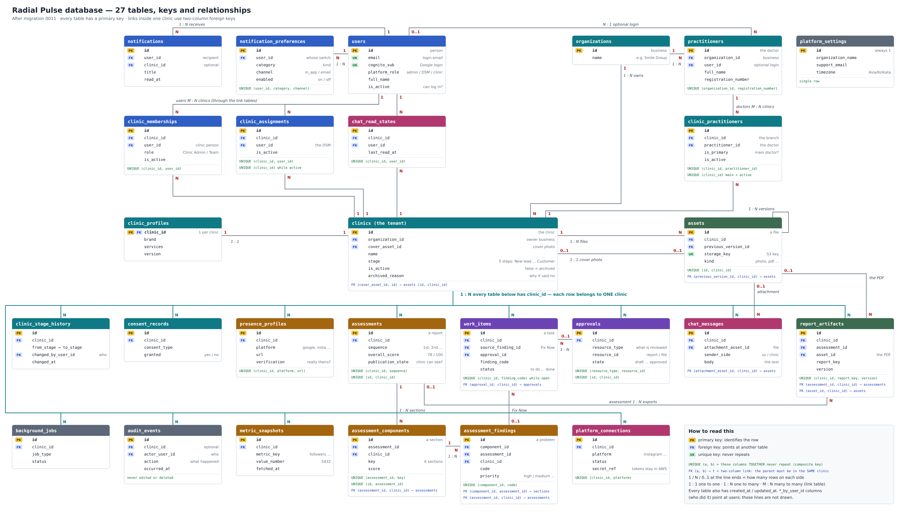
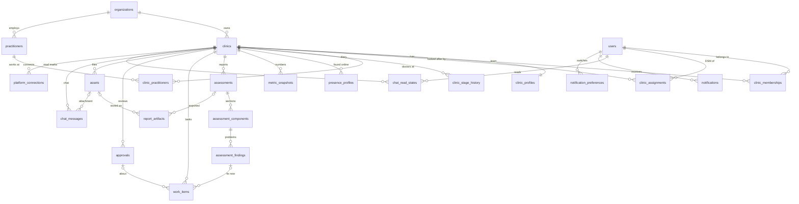

# Database keys and relationships

Radial Pulse backend · all 27 tables · after migration **0011** · 28 Sep 2026

(Full-size picture: `database-diagram.png`, or `database-diagram.svg` to zoom without blur.)

This page answers two questions for every table:
1. **How is one row identified?** (primary key, and the natural / composite keys)
2. **How is it linked to other tables?** (1:1, 1:N, M:N)

Everything below was read from a real PostgreSQL 16 database built by the migrations, so it
matches what the code actually creates.

---

## 1. The words, in one line each

| Word | Meaning | Example |
|---|---|---|
| **Primary key (PK)** | The one value that identifies a row. Never repeats, never empty | `clinics.id` |
| **Natural / composite unique key** | Real-world columns that must not repeat **together**. Two or more columns = *composite* | a person can be on a clinic's team only once: `(clinic_id, user_id)` |
| **Foreign key (FK)** | A column that must point at an existing row in another table | `work_items.clinic_id → clinics.id` |
| **Composite foreign key** | Two columns that must point at a parent row **together** | `assessment_findings (assessment_id, clinic_id) → assessments (id, clinic_id)` = the finding's assessment is in the **same clinic** |

### Why every table uses `id` as the primary key (and composite keys as unique keys)

Every table has a primary key called `id` (a UUID, a long random code). The "several columns
identify a row" rule is kept as a **composite unique key** next to it, for example
`clinic_memberships`: PK `id`, unique `(clinic_id, user_id)`.

The database guarantees exactly the same thing either way: the same clinic + person can
never appear twice. We keep a single `id` as well because:

- the API needs one id in the URL (`/clinics/{id}/team/{membership_id}`), not two;
- other tables can point at the row with one column;
- if the rule ever changes (e.g. a person may rejoin a clinic), only the unique key changes,
  not every link to the table.

**Exception:** `clinic_profiles` uses `clinic_id` itself as its primary key, because a
profile *is* the clinic's (exactly one per clinic).

---

## 2. Keys of every table

**PK** = primary key. **Unique keys** = what must never repeat (composite when several columns).
"when …" = the rule only applies to those rows.

### People and access

| Table | PK | Unique keys (natural / composite) | In words |
|---|---|---|---|
| `users` | id | (email) · (cognito_sub) | one account per email and per Google login |
| `organizations` | id | — | two businesses may have the same name |
| `clinic_memberships` | id | **(clinic_id, user_id)** | a person is on a clinic's team once |
| `clinic_assignments` | id | **(clinic_id, user_id)** · (clinic_id) when active | a DSM is assigned to a clinic once; **one active DSM per clinic** |
| `notifications` | id | — | a message log; two identical messages can exist |
| `notification_preferences` | id | **(user_id, category, channel)** | one on/off switch per person, per kind, per channel |

### Clinics and doctors

| Table | PK | Unique keys | In words |
|---|---|---|---|
| `clinics` | id | — | names can repeat (two "Smile Dental"s in different cities) |
| `clinic_profiles` | **clinic_id** | — | exactly one profile per clinic (1:1) |
| `clinic_stage_history` | id | — | a diary: one row per stage move |
| `practitioners` | id | **(organization_id, registration_number)** when the number is known | one record per doctor per business *(new in 0011)* |
| `clinic_practitioners` | id | **(clinic_id, practitioner_id)** · (clinic_id) when main and active | a doctor is linked to a branch once; **one main doctor per clinic** |
| `consent_records` | id | — | a log of what the clinic allowed |

### Online presence and assessments

| Table | PK | Unique keys | In words |
|---|---|---|---|
| `presence_profiles` | id | **(clinic_id, platform, url)** | the same link is stored once per clinic |
| `metric_snapshots` | id | — | a time series: many readings of the same number |
| `assessments` | id | **(clinic_id, sequence)** · (id, clinic_id) | 1st, 2nd, 3rd report of a clinic, each once |
| `assessment_components` | id | **(assessment_id, key)** · (id, assessment_id) | each of the 6 sections once per report |
| `assessment_findings` | id | **(component_id, code)** | each problem once per section *(new in 0011)* |

### Work, review and files

| Table | PK | Unique keys | In words |
|---|---|---|---|
| `work_items` | id | **(clinic_id, finding_code)** when the item is open | only one open task per problem |
| `approvals` | id | **(resource_type, resource_id)** · (id, clinic_id) | one approval per report / file |
| `assets` | id | (storage_key) · (id, clinic_id) | one row per stored file |
| `report_artifacts` | id | **(clinic_id, report_key, version)** | each version of a report once |
| `background_jobs` | id | — | a job queue log |
| `audit_events` | id | — | the activity log (never changed) |

### Chat, connected accounts, settings

| Table | PK | Unique keys | In words |
|---|---|---|---|
| `chat_messages` | id | — | a message log |
| `chat_read_states` | id | **(clinic_id, user_id)** | one "read up to here" mark per person per clinic chat |
| `platform_connections` | id | **(clinic_id, platform)** | one Instagram / Google / … connection per clinic |
| `platform_settings` | id | id must be 1 | exactly one row |

The `(id, clinic_id)` and `(id, assessment_id)` keys look odd: `id` alone is already unique.
They exist so that children can point at **both columns at once** (the same-clinic rule in section 4).

**Tables with no natural key** ("—" above): the logs (notifications, stage history, consent
records, metric snapshots, background jobs, audit events, chat messages) record *events*, and two
identical events can really happen twice; organizations and clinics have names that repeat. For
these the `id` is the only honest identity.

---

## 3. Relationships (1:1, 1:N, M:N)

Read "A 1 : N B" as **one A has many B; each B belongs to one A**.

### One to one (1 : 1)

| A | B | How | Meaning |
|---|---|---|---|
| clinics | clinic_profiles | `clinic_profiles.clinic_id` is its PK and a FK | every clinic has exactly one profile |
| report / file / assessment | approvals | unique `(resource_type, resource_id)` | an item has at most one approval (see note below) |

### One to many (1 : N)

| One (parent) | Many (child) | Link column(s) | Notes |
|---|---|---|---|
| organizations | clinics | clinic.organization_id | a business owns many branches |
| organizations | practitioners | practitioner.organization_id | a business's doctors |
| clinics | assessments | clinic_id | 1st, 2nd, 3rd … report |
| assessments | assessment_components | **(assessment_id, clinic_id)** | 6 sections per report |
| assessment_components | assessment_findings | **(component_id, assessment_id)** | problems found in a section |
| assessments | report_artifacts | **(assessment_id, clinic_id)** | optional: a PDF export of the report |
| assessment_findings | work_items | source_finding_id | optional: "Fix Now" on a finding |
| approvals | work_items | **(approval_id, clinic_id)** | optional |
| clinics | work_items, approvals, assets, report_artifacts, presence_profiles, metric_snapshots, consent_records, clinic_stage_history, background_jobs, chat_messages, platform_connections | clinic_id | everything a clinic owns |
| clinics | notifications, audit_events | clinic_id (optional) | platform-wide rows have no clinic |
| assets | chat_messages | **(attachment_asset_id, clinic_id)** | a file sent in the chat |
| assets | report_artifacts | **(asset_id, clinic_id)** | the stored PDF of a report |
| assets | clinics | **(cover_asset_id, id)** | the clinic's cover photo (0 or 1 per clinic) |
| assets | assets | **(previous_version_id, clinic_id)** | version chain of the same file |
| users | notifications, notification_preferences | user_id | a person's messages and switches |
| users | practitioners | practitioner.user_id | optional: a doctor who also has a login |

**Who-did-it links (all optional N : 1 to `users`):** `created_by_user_id`, `updated_by_user_id`,
`owner_user_id`, `assigned_by_user_id`, `invited_by_user_id`, `changed_by_user_id`,
`decided_by_user_id`, `sender_user_id`, `connected_by_user_id` … on most tables. If that user is
removed, the column becomes empty; the audit log still says who it was.

### Many to many (M : N), through a link table

| A | B | Link table | Extra rule |
|---|---|---|---|
| users (clinic people) | clinics | `clinic_memberships` (+ role) | a person can be on several clinics' teams; a clinic has many people |
| users (DSMs) | clinics | `clinic_assignments` | history is M:N; **at one moment** a clinic has only 1 active DSM (so today's view is clinic N : 1 DSM) |
| practitioners | clinics | `clinic_practitioners` (+ is_primary) | a doctor can work at several branches of the **same** business |
| users | clinics | `chat_read_states` | who has read which clinic's chat up to where |

`platform_connections` joins clinics to a fixed list of platforms (Instagram, Google, …). The
platform is a value, not a table, so this is **clinic 1 : N connections**, max one per platform.

**Note on approvals:** an approval points at "some item" with `(resource_type, resource_id)`: an
assessment, a report or a file. A normal foreign key can point at only one table, so this link is
checked by the application, and since 0009 the database also refuses to save an item whose status
disagrees with its approval.

---

## 4. The same-clinic rule (composite foreign keys, migration 0011)

Many child rows store a `clinic_id` **and** point at a parent. Before 0011 the database only
checked that the parent existed, not that it was **in the same clinic**. A bug could have made
clinic B's report point at clinic A's assessment. Now these links use two columns together:

| Child (columns) | Parent (columns) | If the parent is deleted |
|---|---|---|
| assessment_components (assessment_id, clinic_id) | assessments (id, clinic_id) | children deleted too |
| assessment_findings (assessment_id, clinic_id) | assessments (id, clinic_id) | children deleted too |
| assessment_findings (component_id, assessment_id) | assessment_components (id, assessment_id) | children deleted too |
| report_artifacts (assessment_id, clinic_id) | assessments (id, clinic_id) | refused |
| report_artifacts (asset_id, clinic_id) | assets (id, clinic_id) | refused |
| chat_messages (attachment_asset_id, clinic_id) | assets (id, clinic_id) | refused |
| clinics (cover_asset_id, id) | assets (id, clinic_id) | refused |
| assets (previous_version_id, clinic_id) | assets (id, clinic_id) | refused |
| work_items (approval_id, clinic_id) | approvals (id, clinic_id) | refused |

"Refused" is safe because the platform never hard-deletes these rows (it deactivates them).
`work_items.source_finding_id` keeps "set to empty": findings are replaced when an engine re-runs,
and the work item keeps its `finding_code`.

Checked on PostgreSQL 16: each cross-clinic link above is refused; correct same-clinic links are
accepted; deleting a clinic still removes everything under it; the worker's "replace findings"
still works; undo (downgrade) and redo (upgrade) work.

---

## 5. Diagram (main tables)

(`||` = exactly one · `|o` = zero or one · `o{` = zero or many. VS Code shows it with a Mermaid
preview extension; GitHub shows it automatically.)
